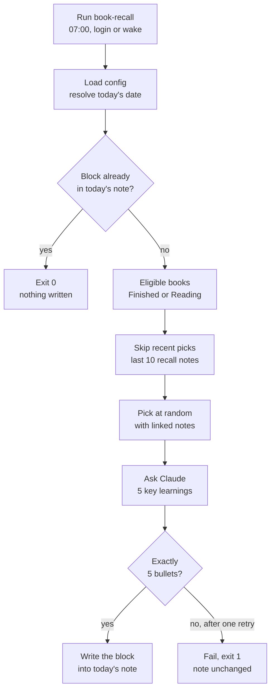

# Daily Book Recall — Feature Brief

Oct 24, 2026 · @Danny

## Summary

`book-recall` is a CLI that runs once a day. It picks one finished or in-progress book from `Books/` at random, asks Claude to boil your notes on it, plus the notes linked to and from it, down to five key learnings, and writes them to that day's recall note in `Daily/Recall/`, which the daily note embeds. It runs on demand or from a scheduled job, and running it twice on the same day is safe.

It sits next to `week-review` in this repo and reuses that tool's patterns: a config file outside the vault, the token in Keychain, marker-delimited blocks and atomic writes.

## Problem and goals

The vault holds detailed notes on books you've finished, but they only get read again if you go looking for them. As of 24 Oct 2026, `Books/` has 133 notes, 54 of them `status: Finished`. 33 notes hold real content (150 to 5,600 words). Most of the rest contain only frontmatter.

Goal: a short daily prompt that brings one book's lessons back into view where you already look each morning, without any manual step.

**In (v1)**

- Pick one eligible book per day at random, without repeating recent picks
- Summarise that book's note, the notes it links to and the passages that link to it into exactly 5 bullet points of key learnings
- Write the summary to its own note, `Daily/Recall/YYYY-MM-DD.md`, shown in the daily note through an embed in `Templates/daily.md`. The tool never creates or edits a daily note (see Edge cases → Obsidian Sync)
- Run from the CLI or a scheduled job. A re-run on the same day leaves the existing block alone unless asked to replace it

**Out (v1)**

- Summarising from the LLM's general knowledge of the book. Only your notes are used
- Following links more than one hop from the book note
- Editing the book note (no `last_recalled` property)
- Spaced repetition, weighting, or rating recalls
- Notifications, email or any channel other than the daily note
- Committing to the vault's git repo

## User experience

One command, no flags needed day to day:

| Command | Does |
| --- | --- |
| `book-recall` | Today (Europe/London): pick a book, summarise, write. If today's note already has a block, do nothing and exit 0 |
| `book-recall --date 2026-10-20` | Same, for a past or future date |
| `book-recall --book "4000 Weeks"` | Skip the random pick and use this note |
| `book-recall --reroll` | Replace today's block with a different book. `--regenerate` keeps the book and re-summarises it |
| `book-recall --dry-run` | Print the block to stdout and write nothing |
| `book-recall --config <path>` | Use a different config file |

On success it prints the note path and one line, e.g. `2026-10-24: added recall — The Phoenix Project`. On failure it prints to stderr and exits non-zero, the same as `week-review`.

**Output: the recall note** `Daily/Recall/2026-10-24.md`, embedded at the end of the daily note by `![[Daily/Recall/{{date:YYYY-MM-DD}}]]` in the template (the bullets below are placeholders):

```markdown
---
type: recall
created: 2026-10-24
---

<!-- book-recall:start -->
## Book recall — [[The Phoenix Project]]

- Placeholder learning one, in one sentence
- Placeholder learning two
- Placeholder learning three
- Placeholder learning four
- Placeholder learning five

_Generated 2026-10-24 07:00 from 1 book note and 2 linked notes (3,104 words) by claude-sonnet-5-5. Re-runs overwrite this block._
<!-- book-recall:end -->
```

The wikilink in the heading is what Obsidian uses for backlinks, so each book note collects a list of the days it came up. The tool also reads that link back to avoid repeats.

## How it works

A TypeScript CLI that reads and writes the vault files directly, like `week-review`. No Obsidian plugin is needed and Obsidian doesn't have to be running.



The tool only writes once Claude returns a valid reply. A day that already has a block stops at the first check.

- **Find books.** Parse frontmatter for every `.md` in `booksFolder`. Keep notes where `type: book`, `status` is in `statuses`, and the body is at least `minWords` long.
- **Avoid repeats.** Read the `book-recall` blocks in the last `noRepeatDays` recall notes (and daily notes, for recalls written there before 25 Oct 2026) and collect the `[[Book]]` link from each. The vault is the history, so there's no state file to lose or sync.
- **Pick.** Choose uniformly from what's left. Tests pass a seeded random function and a fixed clock, as `run()` does today.
- **Gather linked notes.** One hop only, in two directions:
    - Outgoing: each note the book note links to, in full, up to 1,500 words per note. Unresolved links are skipped.
    - Incoming: for each note that links to the book, only the paragraph or list item (with its children) containing the link. Hub notes such as `Books Read` and `2026 Plan` link to many books, and sending them whole would crowd out the book itself.
    - Skipped: `Templates/`, `Archive/tana/`, frontmatter-only stubs, and anything inside a `book-recall` block, so past recalls never feed back in. Other daily-note mentions are kept, because a reflection written on the day can matter.
    - Today only 5 of the 33 eligible books link out, mostly to projects, and most incoming links come from hub notes. For most books the summary will still rest mainly on the book note.
- **Summarise.** One Claude Messages API call. The book note comes first, then the linked context, with each part labelled by its source path. The output must be exactly 5 strings (structured output or a single tool call), so the code can check the count instead of parsing prose.
- **Write.** Reuse the `week-review` logic in `src/note.ts` (`upsertBlock`, `writeAtomic`), with the marker names made a parameter. The block goes in the day's recall note, which only this tool creates; the daily note template embeds it at the end.

Repo shape: a second `bin` entry (`book-recall`) in `package.json`, with code in `src/recall/`. Code shared by both tools (`note.ts`, Keychain loading, the config secret check) moves to `src/shared/`.

## Scheduling

It runs every day you open the laptop and skips days you don't. It never backfills: it always writes to the note for the day it actually runs.

- A launchd user agent (`~/Library/LaunchAgents/com.danny.book-recall.plist`) with `StartCalendarInterval` at 07:00 and `RunAtLoad`. If the laptop is asleep at 07:00, launchd runs the job when it wakes. `RunAtLoad` covers a cold boot and login
- If the laptop isn't opened all day, nothing runs and that day's note gets no block. The catch-up run the next morning resolves to the new day, so the missed day stays empty
- If the laptop is only open before 07:00 and then closed for the rest of the day, that day is also skipped. Move the time earlier if that matters
- Logs go to `~/Library/Logs/book-recall.log`. The plist uses an absolute path to `node` (24 or later) because launchd has no shell `PATH`. The job runs as the logged-in user, so it can read the Keychain
- Cron doesn't fit: it skips runs while the laptop is asleep and has no run-on-wake

Waking, logging in and the 07:00 timer can all fire on the same day. Only the first run writes. Later runs find today's `book-recall` block and exit 0, so you pay for one LLM call per day.

## Configuration

Config lives at `~/.config/book-recall/config.json`, outside the vault. Like `week-review`, it refuses keys that look like secrets. The Anthropic API key comes from the Keychain (service `book-recall`, account `anthropic-api`), and `BOOK_RECALL_API_KEY` overrides it.

| Key | Default | Notes |
| --- | --- | --- |
| `vaultPath` | required | e.g. `~/Documents/Obsidian Vault` |
| `booksFolder` | `Books` | Searched recursively, ignoring `Templates/` |
| `dailyFolder` | `Daily` | Matches `.obsidian/daily-notes.json` |
| `dailyFormat` | `YYYY-MM-DD` | Moment-style, as in `.obsidian/daily-notes.json` |
| `dailyTemplate` | `Templates/daily.md` | Only read to check it embeds the recall notes; the CLI prints a tip until it does |
| `recallFolder` | `<dailyFolder>/Recall` | Where the recall notes go, named like the daily notes |
| `statuses` | `["Finished", "Reading"]` | Allowed `status` values. Backlog and Abandoned books are skipped |
| `minWords` | `150` | Notes shorter than this (body only, not frontmatter) are skipped |
| `noRepeatDays` | `10` | A book shown in the last N recall notes isn't picked |
| `linkedNotes` | `true` | Include outgoing linked notes and incoming link passages |
| `maxLinkedWords` | `4000` | Total cap on linked context. Trimmed before the book note is ever cut |
| `model` | `claude-sonnet-5-5` | Any Claude model ID |
| `timezone` | `Europe/London` | Decides which day counts as "today" |

With today's defaults, 33 books are eligible (31 Finished, 2 Reading) and none repeat for 10 days, so each run picks from at least 23 books.

## Edge cases and failure handling

Every check happens before the write. If any step fails, the recall note is left exactly as it was.

| Case | Behaviour |
| --- | --- |
| No eligible books (e.g. all shown recently) | Relax `noRepeatDays` to pick the least recently shown book; fail only if `Books/` has none eligible at all |
| Daily note missing | Nothing to do: the recall note is written anyway and shows up once the daily note exists |
| Obsidian Sync | A note created on two devices within minutes keeps the remote copy without merging. On 25 Oct 2026 the tool created the daily note at 07:03 while the phone created its own, and the recall was lost. So the tool writes only its own recall note, which no other device creates. Opening an embed that doesn't exist yet would create the note on that device, so leave it until the recall arrives |
| Note already has a block | Default: no-op, exit 0. `--regenerate` / `--reroll`: replace the block in place |
| Unmatched or repeated markers | Fail and ask for a manual fix (same rule as `week-review`) |
| API down, 401, rate limit, timeout | Retry up to 3 times, waiting 5s, 10s and 20s, then fail non-zero. Nothing is written |
| LLM reply isn't exactly 5 bullets | Validate the output; retry once with the error included, then fail |
| Very long note | The longest today is 5,618 words (about 8k tokens), so one call is enough. Linked context is trimmed to `maxLinkedWords` first; the book note is truncated only as a last resort |
| Note contains Tana leftovers (`tana_id`, ☐/☑ bullets) | Remove frontmatter before sending. Leave the body as-is; the prompt tells the model to ignore checklist scaffolding |
| Obsidian or Sync writing at the same time | Atomic write (temp file + rename), then re-read the note to confirm the block is there |

**Prompt rules.** The model sees the book note body, title and author, then the linked context, with each part labelled by its source path. It's told to use only what's in the notes, return exactly 5 bullets of one sentence each with no preamble, and keep your own wording and examples where possible. Notes stay on the laptop apart from that one API call.

## Success criteria and open questions

**v1 built** (against a test copy of the vault, LLM stubbed in tests)

- Selection, the no-repeat window, linked-note gathering, daily-note creation and marker upsert are covered by tests with a fixed seed and clock
- A forced re-run never produces 2 blocks or 2 recall notes
- An LLM failure or bad reply leaves the note byte-for-byte unchanged

**v1 done** (on the real vault, scheduled)

- Over 14 days, every day the laptop is opened gets a recall block with no manual run, and days it isn't opened get none
- 0 repeated books within 10 days
- You recognise every bullet as something from your own notes, with no invented content (self-check on the first 14)

**Open questions**

None.
